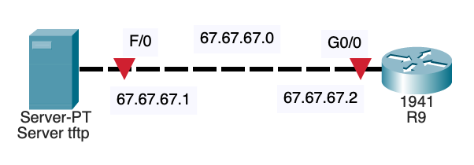
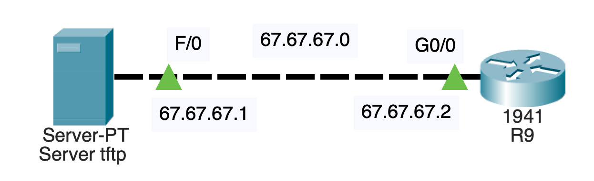

## Actualizar los routers 
**version vieja** 
```
c1900-universalk9-mz.SPA.151-1.M4.bin
```

**version nueva**
```
c1900-universalk9-mz.SPA.155-3.M4a.bin
```



### version
**Comando**
```bash
en
sh ver | inc System img
```
**Salida**
```text
System image file is "flash0:c1900-universalk9-mz.SPA.151-1.M4.bin"
```

### Actualización
**Prender la int**
Router
```bash
en
conf t
int g0/0
ip add 67.67.67.1 255.255.255.0
no sh
ex
ex
```
PC
```bash
ip -> 67.67.67.1
Mask -> 255.255.255.0
Gateway -> 67.67.67.1
```



**Eliminar la version vieja**
```bash
del c1900-universalk9-mz.SPA.151-1.M4.bin
```
O
```bash
del flash:c1900-universalk9-mz.SPA.151-4.M4.bin
```
**Cargar la nueva version**
**Comando**
```bash
en
copy tftp fl
```
**Salida**
```text
Address or name of remote host []? 67.67.67.2

Source filename []? c1900-universalk9-mz.SPA.155-3.M4a.bin

Destination filename [c1900-universalk9-mz.SPA.155-3.M4a.bin]?

Accessing tftp://67.67.67.2/c1900-universalk9-mz.SPA.155-3.M4a.bin...

Loading c1900-universalk9-mz.SPA.155-3.M4a.bin from 67.67.67.2: !!!!!!!!!!!!!!!!!!!!!!!!!!!!!!!!!!!!!!!!!!!!!!!!!!!!!!!!!!!!!!!!!!!!!!!!!!!!!!!!!!!!!!!!!!!!!!!!!!!!!!!!!!!!!!!!!!!!!!!!!!!!!!!!!!!!!!!!!!!!!!!!!!!!!!!!!!!!!!!!!!!!!!!!!!!!!!!!!!!!!!!!!!!!!!!!!!!!!!!!!!!!!!!!!!!!!!!!!!!!!!!!!!!!!!!!!!!!!!!!!!!!!!!!!!!!!!!!!!!!!!!!!!!!!!!!!!!!!!!!!!!!!!!!!!!!!!!!!!!!!!!!!!!!!!!!!!!!!!!!!!!!!!!!!!!!!!!!!!!!!!!!!!!!!!!!!!!!!!!!!!!!!!!!!!!!!!!!!!!!!!!!!!!!!!!!!!!!!!!!!!!!!!!!!!!!!!!!!!!!!!!!!!!!!!!!!!!!!!!!!!!!!!!!!!!!!!!!!!!!!!!!!!!!!!!!!!!!!!!!!!!!!!!!!!!!!!!!!!!!!!!!!!!!!!!!!!!!!!!!!!!!!!!!!!!!!!!!!!!!!!!!!!!!!!!!!!!!!!!!!!!!!!!!!!!!!!!!!!!!!!!!!!!!!!!!!!!!!!!!!!!!!!!!!!!!!!!!!!!!!!!!!!!!!!!!!!!!!!!!!!!!!!!!!!!!!!!!!

[OK - 33591768 bytes]

33591768 bytes copied in 0.277 secs (12732840 bytes/sec)
```

**Configurar el Systema**
```bash
en
conf t
bo s f c1900-universalk9-mz.SPA.155-3.M4a.bin
ex
wri
rel
```

**Verificar**
```bash
sh ver | inc System im
```

```text
System image file is "flash0:c1900-universalk9-mz.SPA.155-3.M4a.bin"
```


### Configuracion 
**basico routers**
R8
```bash
en
conf t
hos R8
no ip domain-l
int g0/0
ip add 192.168.40.1 255.255.255.0
no sh
ex
int s0/0/0
ip add 10.10.6.1 255.255.255.252
no sh
ex

```

R7
```bash
en
conf t
hos R7
no ip domain-l
int g0/0
ip add 192.168.30.1 255.255.255.0
no sh
int s0/0/0
ip add 10.10.6.2 255.255.255.252 
cl r 2000000
no sh
int s0/0/1
ip add 10.10.5.1 255.255.255.252
cl r 2000000
no sh
ex

```
R6
```bash
en
conf t
Hos R6
no ip domain-l
int s0/0/1
ip add 10.10.5.2 255.255.255.252
no sh
int g0/0
ip add 209.180.10.1 255.255.255.0
no sh
int s0/0/0
ip add 10.10.4.1 255.255.255.0
no sh
ex

```
R5
```bash
en
conf t
hos R5
no ip domain-l
int s0/1/0
ip add 10.10.4.2 255.255.255.252
cl r 2000000
no sh 
int s0/0/1
ip add 10.10.3.1 255.255.255.252
cl r 2000000
no sh
int s0/0/0
ip add 10.10.2.0 255.255.255.252
cl r 2000000
no sh
ex

```
R4
```bash
en 
conf t
hos R4
no ip domain-l
int s0/0/1
ip add 10.10.3.2 255.255.255.252
no sh
int g0/0
ip add 192.168.15.1 255.255.255.0
no sh
ex
```
R2
```bash
en
conf t
hos R2
no ip domain-l
int s0/0/0
ip add 10.10.2.2 255.255.255.252
no sh
int s0/0/1
ip add 10.10.1.1 255.255.255.252
no sh
int g0/0
ip add 192.168.0.1 255.255.255.0
no sh
int g0/1
ip add 192.168.10.1 255.255.255.0
no sh
ex

```
R3
```bash
en
conf t
hos R3
no ip domain-l
int s0/0/1
ip add 10.10.1.2 255.255.255.252
cl r 2000000
no sh
int s0/0/0
ip add 10.10.0.1 255.255.255.252
cl r 2000000
no sh
ex
```
R1
```bash
en
conf t
hos R1
no ip domain-l
int s0/0/0
ip add 10.10.0.2 255.255.255.252
no sh
int g0/0
ip add 192.168.5.1 255.255.255.0
no sh 
ex
```

**Routeo**
R1
```bash
en
conf t
int l 1 
ip add 1.1.1.1 255.255.255.255
no sh
ex
rou e 67
no auto
ei r 1.1.1.1
net 10.10.0.0 0.0.0.3
net 192.168.5.0 0.0.0.255
pas g0/0
ex
```
R3
```bash
en
conf t
int l 3
ip add 3.3.3.3 255.255.255.255
no sh
ex
rou e 67
no auto
ei r 3.3.3.3
net 10.10.0.0 0.0.0.3
net 10.10.1.0 0.0.0.3
ex
```
R2
```bash
en
conf t
int l 2
ip add 2.2.2.2 255.255.255.255
no sh
ex
rou e 67
no au
ei ro 2.2.2.2
net 10.10.0.0 0.0.0.3
net 10.10.2.0 0.0.0.3
net 192.168.0.0 0.0.0.255
net 192.168.10.0 0.0.0.255
pass g0/0
pass g0/1
ex
```

R5
```bash
en 
conf t
int l 5 
ip add 5.5.5.5 255.255.255.255
no sh
ex
rou ei 67
ei r 5.5.5.5
no au
net 10.10.2.0 0.0.0.3
net 10.10.3.0 0.0.0.3
net 10.10.4.0 0.0.0.3
ex
```

R4
```bash
en
conf t
int l 4
ip add 4.4.4.4 255.255.255.255
no sh
ex
rou e 67
ei r 4.4.4.4
no au
net 10.10.3.0 0.0.0.3
net 192.168.15.0 0.0.0.255
pass g0/0
ex
```

R6
```bash
en
conf t
int l 6
ip add 6.6.6.6 255.255.255.255
no sh 
ex
rou e 67
ei r 6.6.6.6
no au 
net 10.10.4.0 0.0.0.3
net 10.10.5.0 0.0.0.3
net 209.180.10.0 0.0.0.255
pass g0/0
ex

```

R7
```bash
en 
conf t
int l 7
ip add 7.7.7.7 255.255.255.255
no sh 
ex
rou e 67
ei r 7.7.7.7
pass G0/0
net 10.10.5.0 0.0.0.3
net 10.10.6.0 0.0.0.3
net 192.168.30.0
ex
```

R8
```bash
en
conf t
int l 8
ip add 8.8.8.8 255.255.255.255
no sh 
ex
rou e 67
ei r 8.8.8.8
no au
net 10.10.6.0 0.0.0.3
net 192.168.40.0 0.0.0.255
pass g0/0
ex
```


**sysLOG**
si no aparece lo del syslog
```bash
license boot module c1900 technology-package securityk9
```
confirmar que esta activo 
```bash
do sh ver | sec Tec
```

```text
Technical Support: http://www.cisco.com/techsupport

Technology Package License Information for Module:'c1900'

Technology Technology-package Technology-package

Current Type Next reboot
```

con el current se confirma que funcioan el ips

```bash
en
sh clo
clo s 12:36:00 25 nov 2026
conf t
ser tim log da m
logg h 192.168.40.10
logg tr de
do mkdir flash:ips
ip ips 
ip ips c l flash:ips
ip ips no l
ip ips na R8-IPS
ip ips signature-category
category all
retired true
exit
category ios_ips basic
retired false
exit
interface g0/0
ip ips R8-IPS out
exit
ip ips signature-definition
signature 2004 0
status
retired false
enabled true
exit
engine
event-action produce-alert
event-action deny-packet-inline
exit
exit
exit
```
como deberia funcionar 

```text
*Mar 01, 00:10:15.1010: %IPS-4-SIGNATURE: Sig:2004 Subsig:0 Sev:25 [192.168.0.10 -> 192.168.40.10:0] RiskRating:25
*Mar 01, 00:10:21.1010: %IPS-4-SIGNATURE: Sig:2004 Subsig:0 Sev:25 [192.168.0.10 -> 192.168.40.10:0] RiskRating:25
*Mar 01, 00:10:27.1010: %IPS-4-SIGNATURE: Sig:2004 Subsig:0 Sev:25 [192.168.0.10 -> 192.168.40.10:0] RiskRating:25
*Mar 01, 00:10:33.1010: %IPS-4-SIGNATURE: Sig:2004 Subsig:0 Sev:25 [192.168.0.10 -> 192.168.40.10:0] RiskRating:25
*Mar 01, 00:11:38.1111: %IPS-4-SIGNATURE: Sig:2004 Subsig:0 Sev:25 [192.168.0.10 -> 192.168.40.10:0] RiskRating:25
*Mar 01, 00:11:44.1111: %IPS-4-SIGNATURE: Sig:2004 Subsig:0 Sev:25 [192.168.0.10 -> 192.168.40.10:0] RiskRating:25
*Mar 01, 00:11:50.1111: %IPS-4-SIGNATURE: Sig:2004 Subsig:0 Sev:25 [192.168.0.10 -> 192.168.40.10:0] RiskRating:25
```

**SEGURIDAD EN CAPA 2**
2.
```text
Configure la seguridad de puerto en SW4, en el puerto fa0/6 configure la seguridad de puerto para que solo acepte una dirección MAC. En el puerto fa0/5 configure la seguridad de puerto para que solo acepte la dirección MAC de la PC-E.
```

SW4
```bash
en
conf t
hos SW4
no ip domain-l
int f0/6
sw m a 
sw po
sw por mac s
sw por max 1
sw por v s 
int f0/5
sw m a
sw po
sw por mac 0002.17C6.6891
sw por max 1
sw por v s

```

comandos para verificar 
```bash
sh por int f0/5
sh por a
```

**ASA**
```bash
en
conf t
hos ASA0
domain-name laboratorio.local
ena pass cisco
passwd class
conf t

interface vlan 1
 nameif inside
 security-level 100
 ip address 192.168.20.1 255.255.255.0
 no sh
 ex

interface vlan 2
 nameif outside
 security-level 0
 ip address 209.180.10.2 255.255.255.0
 no sh
 ex

interface vlan 3
 no forward interface vlan 1
 nameif dmz
 security-level 50
 ip address 192.168.25.1 255.255.255.0
 no sh
 ex

interface ethernet0/0
 switchport access vlan 2
 no sh
 ex

interface ethernet0/1
 switchport access vlan 1
 no sh
 ex

interface ethernet0/2
 switchport access vlan 3
 no sh
 ex

route outside 0.0.0.0 0.0.0.0 209.180.10.1

object network RED_INSIDE
 subnet 192.168.20.0 255.255.255.0
 nat (inside,outside) dynamic interface
 ex
 
conf t
class-map inspection_default
 match default-inspection-traffic
 exit

policy-map global_policy
 class inspection_default
  inspect icmp
  exit
 exit
conf t
service-policy global_policy global

int vlan1
ip add 192.168.20.1 255.255.255.0
ex
dhcpd add 192.168.20.100-192.168.20.130 in
dhcpd en in

username admin pass class privilege 15
aaa authentication ssh console LOCAL
aaa authentication enable console LOCAL

crypto key generate rsa modulus 1024
ssh version 2
ssh timeout 5

ssh 192.168.20.0 255.255.255.0 in

object network SERVIDOR_WEB
 host 192.168.25.10
 nat (dmz,outside) static 209.180.10.3
 exit
 conf t
 
access-list OUTSIDE_DMZ extended permit tcp any host 192.168.25.10 eq 80
access-list OUTSIDE_DMZ extended permit tcp any host 192.168.25.10 eq 443
access-group OUTSIDE_DMZ in interface outside

```

**IPSec**
R2
```bash
en
conf t

cry is p 10
 en 3
 h m
 a p
 g 5
 l 72000
 ex

crypto is k Llave123 a 10.10.3.2
acc 110 p ip 192.168.10.0 0.0.0.255 192.168.15.0 0.0.0.255

cry ipsec transform-set VPN-R2-R4 esp-aes esp-sha-hmac

cry m MAPA-VPN 10 i
 s pe 10.10.3.2
 s t VPN-R2-R4
 m a 110
 ex

int s0/0/0
 cry m MAPA-VPN
 ex

```
R4
```bash
en
conf t

cry is p 10
 en 3
 h m
 a p
 g 5
 l 72000
 ex

cry is k Llave123 a 10.10.2.2

acc 110 p ip 192.168.15.0 0.0.0.255 192.168.10.0 0.0.0.255

cry ipsec transform-set VPN-R2-R4 esp-aes esp-sha-hmac

cry map MAPA-VPN 10 ipsec-isakmp
 s pe 10.10.2.2
 s t VPN-R2-R4
 m a 110
 ex

int s0/0/1
 cry m MAPA-VPN
 ex

```

verificar 

```bash
show cry isa p
show cry isa sa
show cry ipsec sa
show cry m
show acc 110
```

**Tunnel GRE**
R1
```bash
en
conf t
int t 67
ip add 172.16.20.1 255.255.255.252
t d 10.10.1.1
t s s0/0/0
ex
ip route 192.168.0.0 255.255.255.0 172.16.20.2
```
R2
```bash
en
conf t
int t 67
ip add 172.16.20.2 255.255.255.252
t d 10.10.0.2
t s s0/0/1
ex

ip route 192.168.5.0 255.255.255.0 172.16.20.1
```


```bash

```


pregunta de examen 

```bash
en
conf t 
ena se ADMON_R7
us admin pri 15 s ADMON_R7
aa n
aa authentication l d local
end
ex


en view
pars v VISTA_R7
co ex in configure terminal
co ex in show running-config
co ex in all show ip eigrp
co conf in router eigrp


ena view VISTA_R7

```

