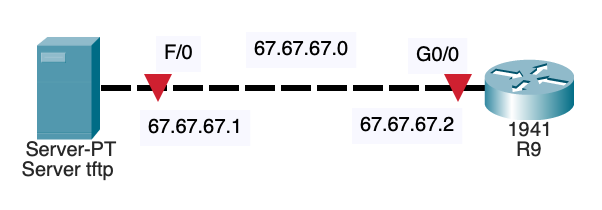
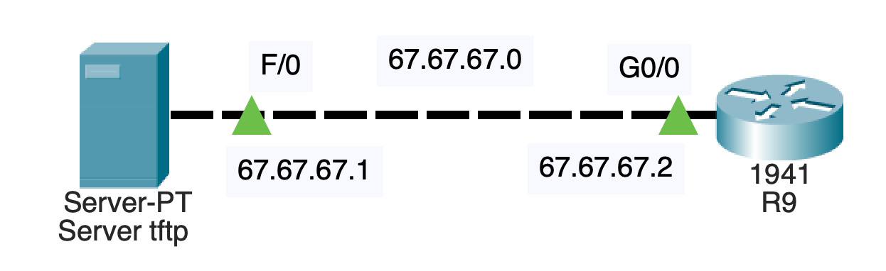

# Cisco 1900 · IOS Upgrade

This final project documents a Cisco 1941 router upgrade over TFTP. The lab notes capture the IOS image in use before the upgrade, the transfer to flash, and the image reported after the reload.

| Stage | IOS image |
| --- | --- |
| Before | `c1900-universalk9-mz.SPA.151-1.M4.bin` |
| After | `c1900-universalk9-mz.SPA.155-3.M4a.bin` |

## Lab topology

The TFTP server connects directly to router R9 on `GigabitEthernet0/0`. The diagrams show the link before and after the interface comes up.





The diagrams label the server `67.67.67.1` and the router `67.67.67.2`. The console transcript records the router at `67.67.67.1/24` and the TFTP host at `67.67.67.2`.

## Upgrade and verification

1. **Check the running image.** The router initially reported the `SPA.151-1.M4` image in `flash0:`.
2. **Transfer the new image.** The TFTP session copied `c1900-universalk9-mz.SPA.155-3.M4a.bin` to flash and reported **33,591,768 bytes copied**.
3. **Set the boot image and reload.** The router was configured to boot from the new image, the configuration was saved, and the router was reloaded.
4. **Verify the running image.** After the reload, `show version` reported the following line.

   ```text
   System image file is "flash0:c1900-universalk9-mz.SPA.155-3.M4a.bin"
   ```

[Original lab notes and console transcript (Spanish)](Proyecto%20Final.md)
