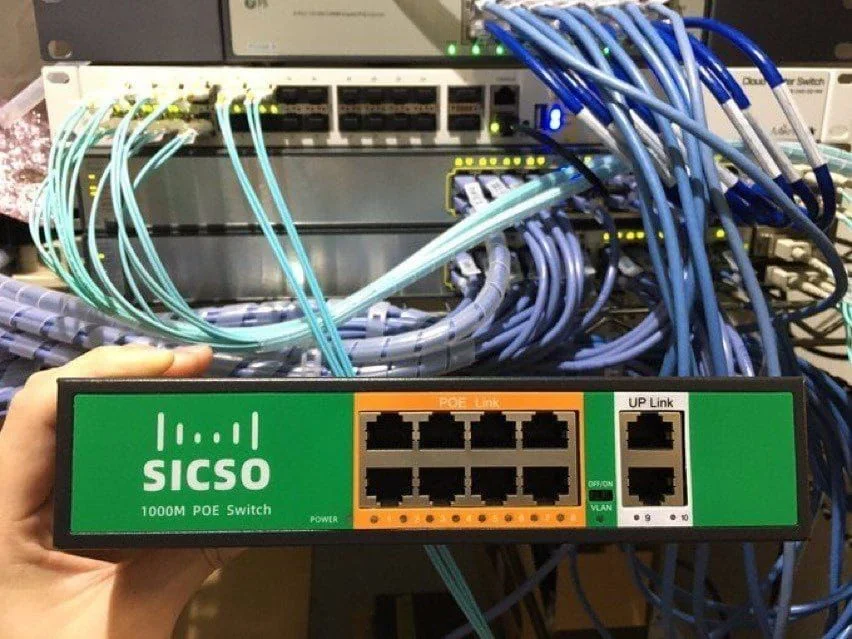

<h1 align="center">SICSO</h1>

  

Browse simulated topologies and hands-on labs with Cisco routers and switches. The lab notes are primarily in Spanish and include addressing tables, IOS commands, and console output.

## Lab index

| Lab | What to look for |
| --- | --- |
| **[Cisco IOS upgrade](Proyecto%20Final/)** | Follow the TFTP transfer to a Cisco 1941 router, then check which IOS image is running after the reload. |
| **[Packet Tracer exercise](Ejer/Ejercicio%201.md)** | Work through the exercise with its companion simulation file. |
| **[GRE tunnel](Adnim/Tarea%204%20Tunnel%20GRE/Tarea%204%20Tunnel%20GRE.md)** | Use the addressing table to follow the tunnel configuration. |
| **[Physical equipment lab](Adnim/Practica%20Fisica%201/Practica%2012%20y%2013%28fisica%29.md)** | Browse the setup steps and Cisco CLI output from the equipment lab. |

## Packet Tracer

<table>
  <tr>
    <td align="center" valign="middle">
      
    </td>
    <td>
      
    </td>
  </tr>
</table>

## Networking notes

| Area | Topics |
| --- | --- |
| IP addressing | [Subnetting](Temas/Subnet.md) |
| Switching and routing | [VLANs](Temas/Vlans.md) · [Routing](Temas/ruteo.md) · [Redundancy](Temas/Redundancia.md) |
| Traffic control | [NAT](Temas/Nat.md) · [Access control lists](Temas/ACL.md) |
